# 4square

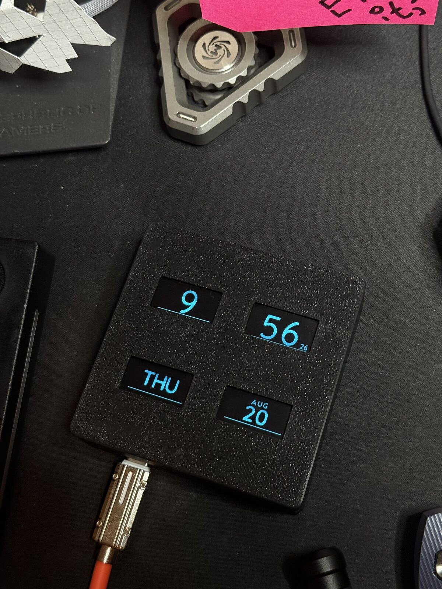

[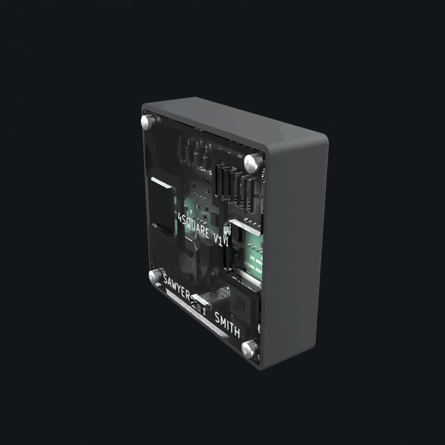](docs/media/4square-exploded.gif)

4square is a small desk clock built around four 0.96 in OLED panels in a 2x2
grid: hours top-left, minutes top-right, weekday and date along the bottom. It
runs on an ESP32-C3 SuperMini on a custom 74 x 74 mm board, in a 3D-printed
shell with a laser-cut clear acrylic back that shows the board. To protect the
panels from burn-in, every pixel goes through one function that applies a pixel
shift and a brightness cap, and a prover on your PC checks every screen the
firmware can draw before an image ships.

| | |
|---|---|
| MCU | ESP32-C3 SuperMini (RISC-V, WiFi, native USB-C) |
| Displays | four 0.96 in 128x64 SSD1306 OLEDs, all white, behind a PCA9548A I2C mux |
| Timekeeping | DS3231 RTC with CR2032 backup |
| Sensors | SHT31 temperature and humidity, phototransistor light sensor |
| Indicators | three addressable RGB LEDs in a vertical column |
| Input | four buttons: MODE, SET, UP, DOWN |
| Settings storage | 24LC256 EEPROM, wear-levelled, survives reflashing |
| Board | custom 74 x 74 mm, 2 layer, rev O, JLCPCB assembly plus a hand-solder kit |
| Case | rev 5 PETG prints plus a rev 6 laser-cut 3 mm acrylic back with engraving, about 79 x 79 mm |
| Power | USB-C, either the rear port or the SuperMini's own |

This repository has everything needed to build one: firmware, a prebuilt image,
the board's manufacturing files and the case.

## Repository layout

    firmware/               the firmware (Arduino sketch + src/) and build.sh
    release/                prebuilt demo image, flash.sh, checksums
    tools/layoutcheck/      the layout prover (runs on your PC, not the board)
    tools/ledcheck/         the LED animation prover
    tools/pageshot/         renders any page to a PNG on your PC
    tools/secretsweep/      lists the credential literals a build must not leak
    hardware/               board notes, gerbers, BOM, CPL, kit list, board PDF, KiCad file
    case/                   printable STLs, the acrylic back DXF, build123d sources
    docs/BUILD.md           assembly, step by step
    docs/media/             photos and renders
    LICENSE                 MIT

## Hardware

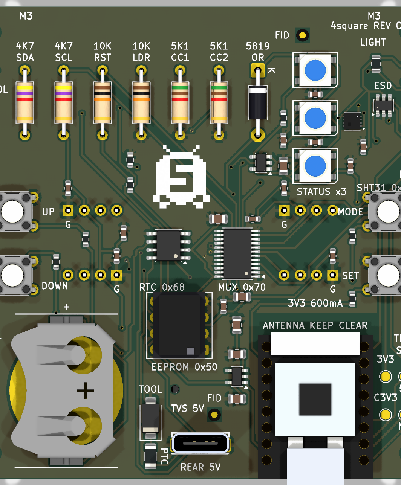

The board is two layers, 74 x 74 mm. The screens plug into sockets on the
front; everything else is on the back. Surface-mount parts are all on one side
so the board can be ordered as JLCPCB Economic assembly, and a short kit of
through-hole parts (the EEPROM socket, axial resistors, buttons, battery clip,
rear USB-C and headers) is soldered by hand. The axial resistors are there on
purpose: through the acrylic back they read as a colour-band ladder.

- [`hardware/HARDWARE.md`](hardware/HARDWARE.md): every part, the pin map, the
  mux channel for each screen, and two silkscreen errors on rev O worth
  knowing before you solder.
- [`hardware/ORDER-NOTES.md`](hardware/ORDER-NOTES.md): placing the JLCPCB
  order and checking the placement preview.
- `hardware/4square-revO-gerbers.zip`, `bom.csv`, `cpl.csv`, `kit-bom.csv`: the
  order package as it was sent.
- `hardware/4square-revO-board.pdf`: plots of every copper and silk layer.
- `hardware/kicad/4square-revO.kicad_pcb`: the KiCad 9 board file.

## Case

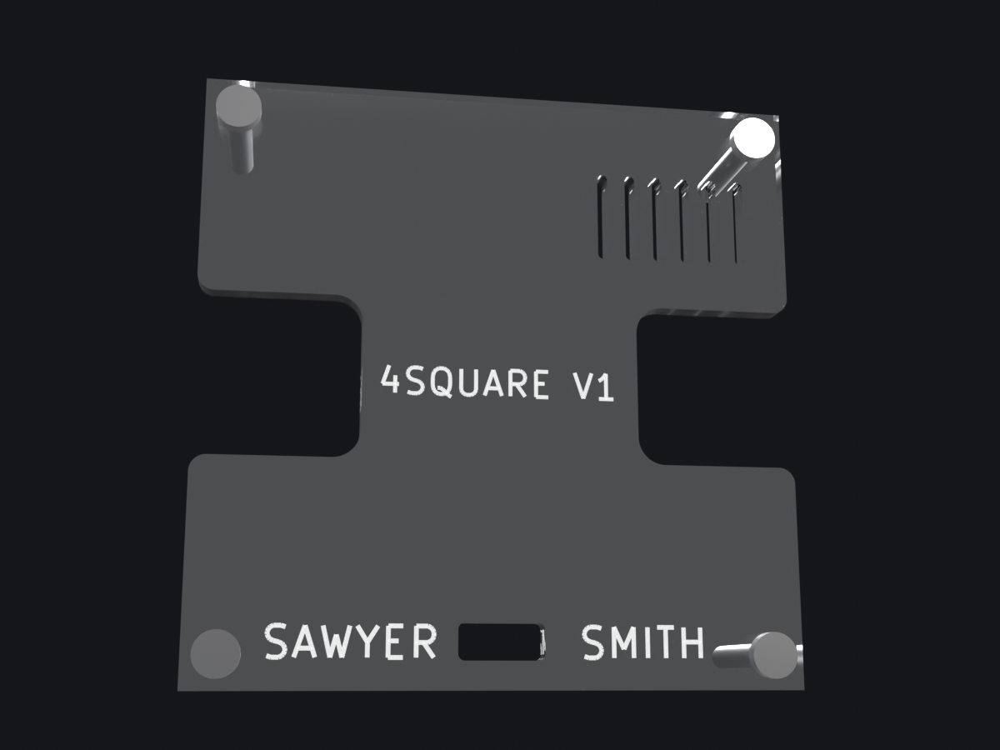

Front to back: a printed shell with a pocket for each screen, a two-piece
retainer that holds the screens flat against the glass, the board on the
shell's corner bosses, a printed standoff frame, and a 3 mm clear acrylic back.
Four M3 x 16 self-tapping screws hold it together. A printed back can replace
the acrylic and frame if you have no laser cutter.

The acrylic is engraved on its inside face, so the DXF is drawn mirrored,
inside-face-up. [`case/README.md`](case/README.md) has the print settings,
orientation, and the cutter notes; [`docs/BUILD.md`](docs/BUILD.md) has the
assembly order.

## Firmware

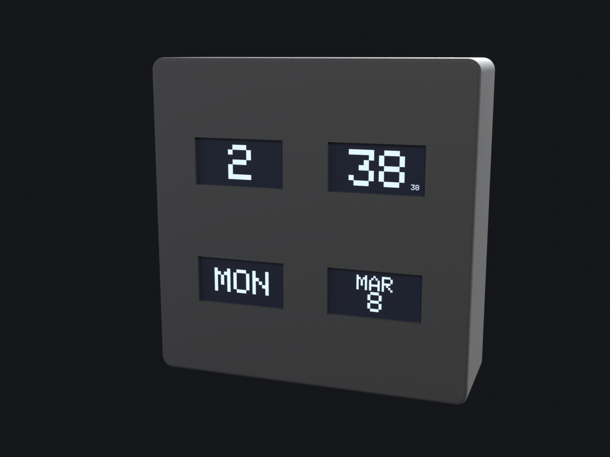

### Buttons

Each button owns a page, and pressing the same button again cycles that
page's variants, so there is no menu to navigate.

| button | page | press it again |
|---|---|---|
| MODE | clock | next clock style: outline, filled, then five more faces each in outline and filled (12 in all) |
| SET | readings: temperature, network, uptime, light | second set: humidity, IP, ambient light, day or night |
| UP | stopwatch: minutes, seconds, state, hours | starts or resumes it; DOWN on this page pauses, then clears |
| DOWN | animations | first press starts the showreel; second press drops to a shuffled roster of the 48x48 animations |

Long press (600 ms): MODE toggles the status LEDs; SET opens the settings
page. On the settings page SET moves to the next item, UP and DOWN change it,
MODE leaves. It times out back to the clock after 30 s.

The stopwatch replaced an earlier stock ticker page. It runs on `millis()`,
keeps counting while you look at other pages, and UP always brings it back.
Minutes carry into the hours panel.

The showreel is a 66 second loop that treats the 2x2 as one scene: a giant
clock, a walking figure crossing both panels of a row, live sensor readings, a
forecast with animated skies, demo market quotes and a heartbeat across all
four panels.

Settings items: LIGHT SENS (how strongly auto-dim responds), TEMP UNIT (C or F,
global), AUTO OFF (a daily screens-off window), SLEEP AT and WAKE AT (its
times, in 15 minute steps). The panels dim from 22:30 to 07:00 and, by
default, switch off entirely from 23:30 to 06:30. Settings already stored in the
EEPROM win over these defaults, and AUTO OFF on the settings page turns the
schedule off.

Until SW1-SW4 are fitted, the buttons can also be pressed over serial (`B0` to
`B3`, `B0L` to `B3L` for a long press).

### Designed for panel lifetime

These panels are rated around 10,000 hours, and a clock runs 8,760 hours a
year, so burn-in is the most likely way this clock fails. The firmware limits it
in six ways:

- **One route to the glass.** `firmware/foursquare/src/screens/display.cpp` is
  the only file that can write to a panel; the four `Adafruit_SSD1306` objects
  have internal linkage there. Every other drawing routine is handed a
  `GFXcanvas1` in RAM, and `disp_commit()` blits canvas to panel, applying the
  pixel shift, the brightness cap and the night policy on the way. Because a
  new clock face has no other route to a panel, it always gets the shift and
  the cap.
- **Pixel shift.** The image walks a serpentine tour inside a 6 px margin,
  spending exactly equal time at every offset.
- **Outline digits by default.** Hollowing a large digit cuts it from about 800
  lit pixels to about 170.
- **Brightness is a lifetime setting.** Contrast, precharge and VCOMH are set
  together, capped by day and hard-limited at night; inverted display is never
  used.
- **Dark when nobody is looking.** A night window dims, a daily window switches
  the panels off, and a button press inside either wakes them for 30 s.
- **Idle LEDs are dark**, and every held LED state has a time budget, because
  the clock lives in a bedroom.

### The layout prover

    tools/layoutcheck/build.sh            # shipping build's screens
    DEMO=1 tools/layoutcheck/build.sh     # demo build's screens

It compiles the firmware's own `faces.cpp`, `pages.cpp`, `anim.cpp` and
`defaults.cpp` on your PC against the real Adafruit_GFX library and renders
every screen the firmware can draw (about 244,000 of them, including every
stopwatch reading). It fails if any pixel is claimed by two elements, if any ink
falls outside the safe area `x[6..121] y[6..57]` that the pixel shift needs, or
if an animation has a blank or discontinuous frame, and it warns on crowding and
fill factor. Overlap is found by having the firmware mark element boundaries
with `ELEM("name")`; on the host that hook snapshots and clears the canvas, so
the pairwise AND of the element bitmaps is the overlap exactly. On the device
the hook is null. The prover self-tests against planted bugs before it reports.
It needs `g++` and Python with Pillow. `tools/ledcheck/build.sh` does the same
job for the LED animations.

### Settings storage

Settings live in the 24LC256 EEPROM at 0x50, not in the ESP32's flash, so a
firmware flash, a partition change or a full chip erase never loses them. They
are stored as a wear-levelled ring of 128 records, each with a sequence number
and CRC: a torn write costs the last change, not the whole configuration.
Everything read back is range-clamped. Serial `F` factory-resets the ring.

### Serial

115200 baud, native USB CDC. `?` report, `P` settings, `T Y M D h m s` set the
clock, `Z` clear the RTC oscillator-stop flag, `S` rescan screens, `R [n]`
rotate, `D [n]` pin contrast, `I` identify, `F` factory reset, `B0` to `B3`
press MODE/SET/UP/DOWN, `B0L` to `B3L` hold them, `W` stopwatch state. The
board does not reset on DTR/RTS, so reopening the port does not show the boot
banner; `?` prints the state instead.

## Flash

The quickest way to see it run is the prebuilt demo image in `release/`. You
need `esptool` (`pip install esptool`) and a USB-C cable. The SuperMini is
native USB: it appears as `/dev/ttyACM0` on Linux or `/dev/cu.usbmodem*` on
macOS.

    git clone https://github.com/partypancake8/4square_production
    cd 4square_production/release
    ./flash.sh

or by hand:

    esptool --chip esp32c3 --port /dev/ttyACM0 --baud 921600 write_flash --flash_mode dio --flash_freq 80m --flash_size 4MB 0x0 4square-demo-merged.bin

`4square-demo-merged.bin` is the whole flash (bootloader, partition table and
app) and goes at `0x0`. If you only want the app slot, `4square-demo.bin` goes
at `0x10000` with `bootloader.bin` at `0x0`, `partitions.bin` at `0x8000` and
`boot_app0.bin` at `0xe000`. `SHA256SUMS` covers all of them.

If esptool cannot find the chip, hold BOOT on the SuperMini while plugging it
in, then run the command again. Unplug and replug after flashing; the board
boots straight into the clock.

The demo image has no WiFi code in it at all, so it never joins a network and
never needs credentials. Time comes from the DS3231; set it over serial if the
clock chip has never been set.

### Release

**The binaries in `release/` predate the stopwatch.** They were built from the
firmware at commit `c80900a` of this repository, where UP is still the market
ticker page. Everything else (clock faces, showreel, settings, auto-off) matches
the current source. To get the stopwatch, build from source as below.

## Build

There are two builds of the same source:

| build | flag | radio | needs secrets.h | what it is for |
|---|---|---|---|---|
| demo | `-DDEMO_BUILD` | none compiled in | no | showing the clock to people: showreel, Fahrenheit, brighter panels |
| full | (none) | WiFi + OTA | yes | running it at home on your own network |

Install [arduino-cli](https://arduino.github.io/arduino-cli/), the ESP32 core
and the four libraries the sketch uses:

    arduino-cli config init
    arduino-cli config add board_manager.additional_urls https://espressif.github.io/arduino-esp32/package_esp32_index.json
    arduino-cli core update-index
    arduino-cli core install esp32:esp32
    arduino-cli lib install "Adafruit GFX Library" "Adafruit SSD1306" "Adafruit BusIO" "Adafruit NeoPixel"

The current source builds with esp32 core 3.3.7, Adafruit GFX 1.12.6, SSD1306
2.5.16, BusIO 1.17.4 and NeoPixel 1.15.4.

Board and partition scheme:

    FQBN: esp32:esp32:esp32c3:CDCOnBoot=cdc,PartitionScheme=no_fs

`CDCOnBoot=cdc` routes Serial to the SuperMini's native USB.
`PartitionScheme=no_fs` gives two 2 MB app slots with OTA and no filesystem;
settings live in the external EEPROM. Changing the partition scheme needs a USB
flash; OTA cannot rewrite the partition table.

Then:

    firmware/build.sh demo                       # demo image, no secrets needed
    firmware/build.sh full                       # full image, needs src/secrets.h
    firmware/build.sh demo --upload /dev/ttyACM0 # build and flash in one go

`build.sh` runs the layout prover first, for the variant you asked for, and
stops if it fails, so every image passes the prover before it ships
(`--no-check` skips it). It compiles with `--jobs 4` and `--clean`, and passes
`-ffile-prefix-map` so the binary carries no local paths. Output goes to
`firmware/out/<variant>/`: `foursquare.ino.bin` (app) and
`foursquare.ino.merged.bin` (whole flash).

By hand, the demo flag is one compiler define:

    tools/layoutcheck/build.sh
    arduino-cli compile --fqbn esp32:esp32:esp32c3:CDCOnBoot=cdc,PartitionScheme=no_fs \
      --build-property "compiler.cpp.extra_flags=-DDEMO_BUILD" \
      --jobs 4 --output-dir out firmware/foursquare

Use `compiler.cpp.extra_flags`, not `build.extra_flags`: overriding the latter
drops the core's own defines and the SSD1306 library stops compiling. Leave the
define off for the full build. Everything the demo flag changes is inside
`#ifdef DEMO_BUILD` and listed in one place, `firmware/foursquare/src/demo.h`.

### WiFi (full build only)

    cp firmware/foursquare/src/secrets.h.example firmware/foursquare/src/secrets.h

and fill in your SSID and password (two networks are tried in turn; use the
same one twice if you have one) and the SHA256 of your OTA password
(`echo -n 'your-password' | sha256sum`). `secrets.h` is gitignored. The full
build refuses to compile without it; the demo build does not read it.

The credentials are declared `static const` inside `#ifndef DEMO_BUILD`, and
the OTA password is only stored as a digest, so a demo image contains no
credential. `tools/secretsweep/literals.sh secrets.h` prints the values a built
image should be grepped for before you share it. Once the full build is running,
OTA updates go to host `foursquare-revo` with `espota.py -a <your OTA password>`.

## Photos

| | |
|---|---|
|  | 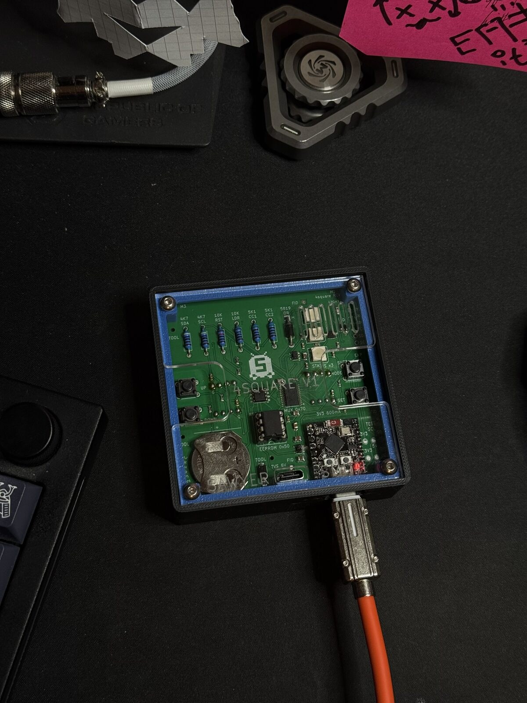 |
| The finished clock | The rev O board seated in the case, back removed |
| 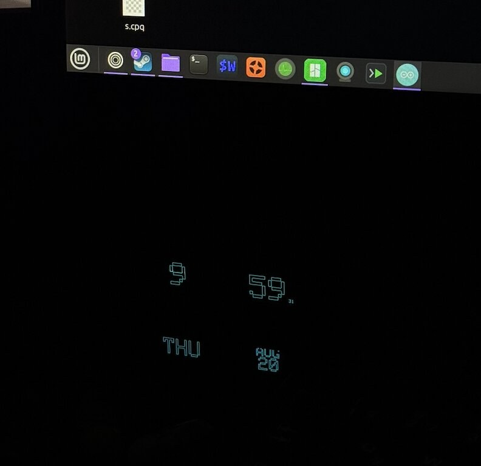 | 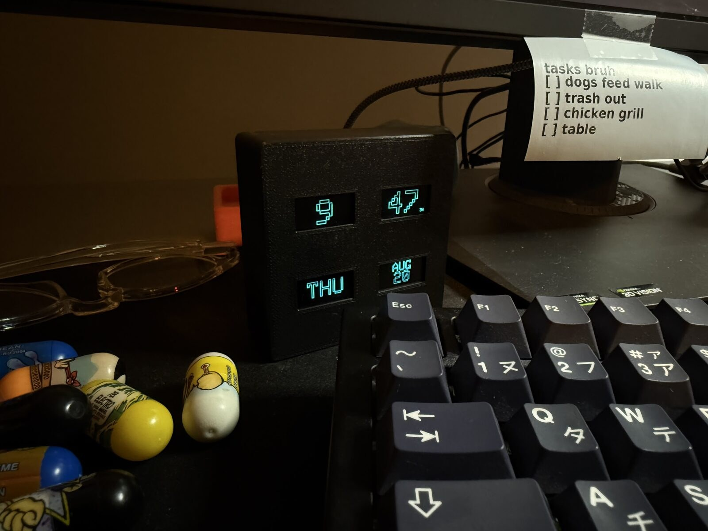 |
| Dimmed for the night window | On the desk |
| 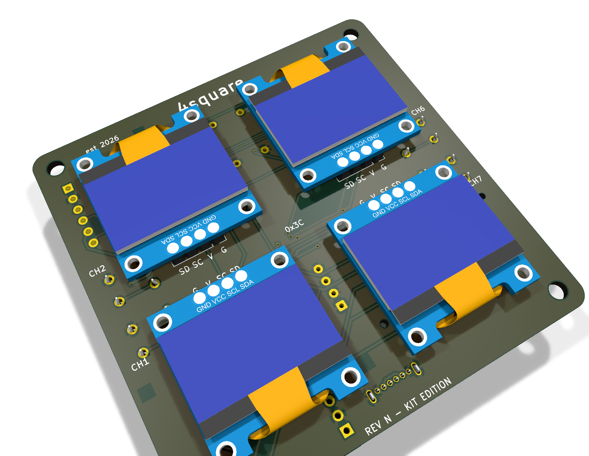 | 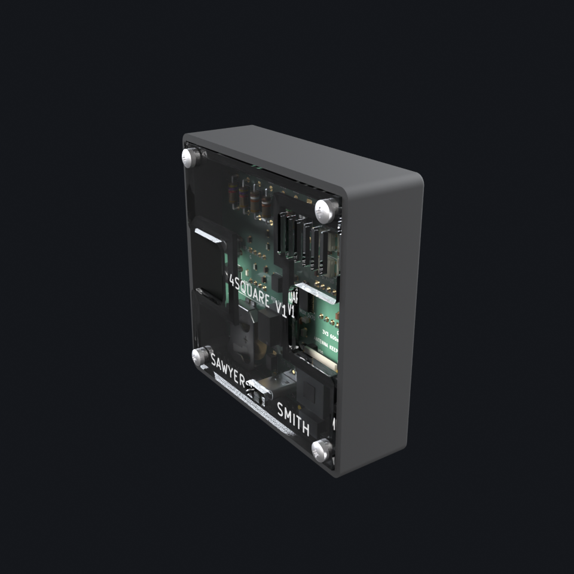 |
| The board with its four screens (KiCad render) | The assembled case (render) |
| 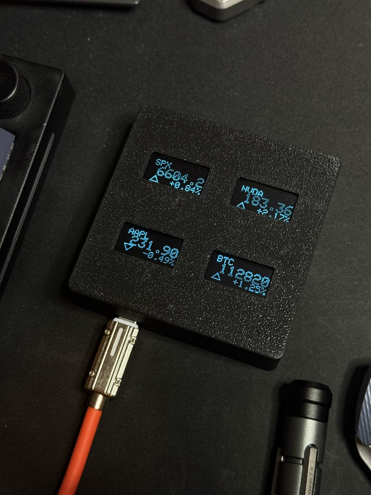 | 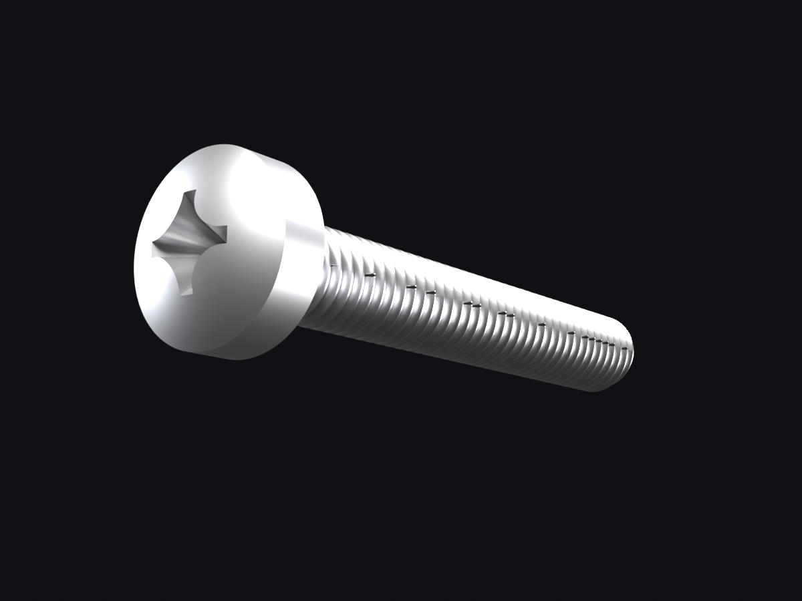 |
| The market ticker page from the earlier firmware, since replaced by the stopwatch | One of the four M3 x 16 self-tapping screws (render) |
| 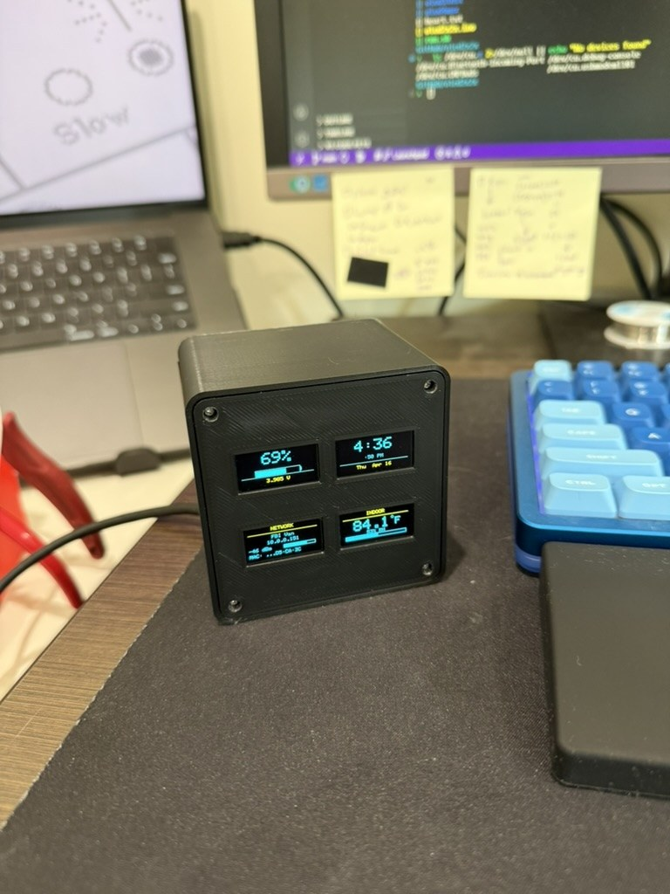 | 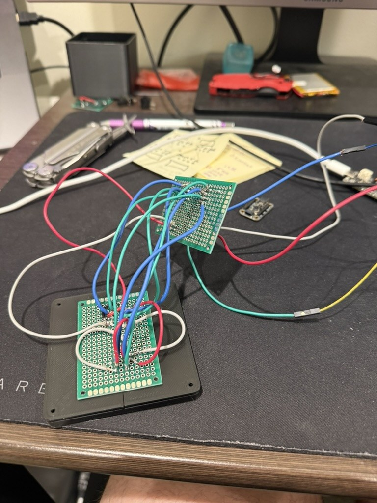 |
| The first prototype, before the custom board | The hand-wired perfboard version |

An MP4 of the exploded view is at
[`docs/media/4square-exploded.mp4`](docs/media/4square-exploded.mp4).

## License

MIT, see [`LICENSE`](LICENSE).
