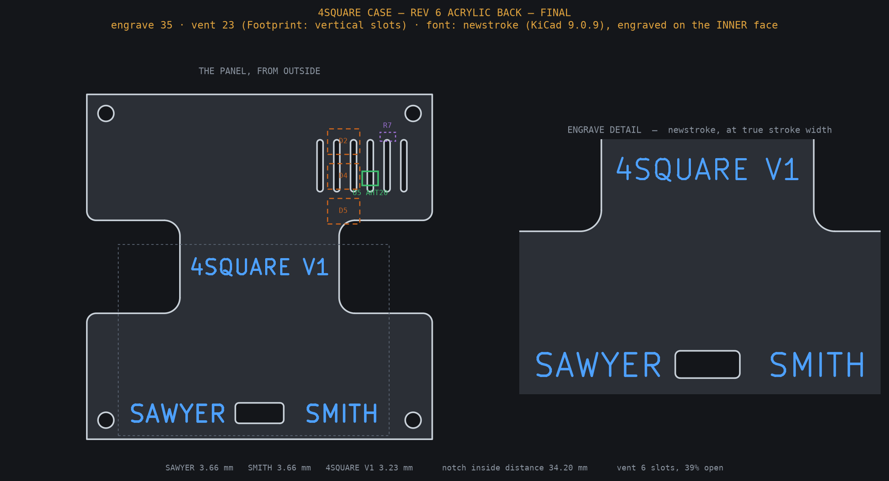

# 4square case

A printed front shell that holds the four screens, a two-piece retainer plate
behind them, the board, and a back. The back is either a printed cover or a
laser-cut clear acrylic panel that shows off the back of the board. The printed
parts are case rev 5; the acrylic back and its standoff frame are case rev 6.
Outside size is about 79 x 79 mm.

## What to make

| file | part | how | time / filament |
|---|---|---|---|
| `4square-shell.stl` | front shell with the four screen pockets | print | 51 min / 34 g |
| `4square-retainer-half-a.stl` | retainer plate, half A | print | 15 min / 8 g |
| `4square-retainer-half-b.stl` | retainer plate, half B | print | 15 min / 8 g |
| `4square-standoff-frame.stl` | standoff frame for the acrylic back | print | 14 min / 4 g |
| `4square-acrylic-back.dxf` | acrylic back | laser cut, 3 mm cast acrylic | |
| `4square-printed-back.stl` | printed back, instead of the acrylic | print | 34 min / 15 g |
| `4square-acrylic-back-reference.stl` | the acrylic back as a solid, for viewing only | do not print | |

Pick one back:

- **Acrylic** (what the photos show): `4square-acrylic-back.dxf` plus
  `4square-standoff-frame.stl`. Flat stock has no standoffs of its own, so the
  frame holds the panel at the right height; without it the screws pull the
  sheet into thin air.
- **Printed**: `4square-printed-back.stl` on its own. Its standoffs are grown in.

Hardware: four M3 x 16 mm self-tapping screws (16 mm or longer). They go in
through the back and thread into the shell's corner bosses.

The times and weights are from Bambu Studio on a 0.4 mm nozzle. The parts were
printed in PETG.

## Printing

Every STL is already oriented for the bed. **Print them as exported, do not
rotate them, and do not add supports.**

| part | lies on the bed as |
|---|---|
| shell | front face down |
| retainer halves | board side down, the screen pads growing upward |
| standoff frame | the flat web down, the four pegs growing upward |
| printed back | outer face down, the standoff tubes growing upward |

The screen pockets in the shell are the alignment jig: the modules sit in them
while the board is soldered, so the pocket walls decide where each screen ends
up. Check that a module drops into each pocket without force before you build.

## Cutting the acrylic back

3 mm cast acrylic. Layers in the DXF:

| layer | operation |
|---|---|
| `CUT` | cut through |
| `ENGRAVE` | mark only. It is a stroke font (open centrelines, one pass each), not outlines to fill. |

What is on the panel:

- two finger notches, 20 mm deep each, 34.2 mm apart on the inside
- six vertical vent slots over the temperature sensor corner, about 39% open
- the four M3 corner holes and an opening for the rear USB-C port
- engraving: "SAWYER" and "SMITH" either side of the USB-C opening, and
  "4SQUARE V1" centred, in the same stroke font KiCad uses for silkscreen

**The DXF is drawn inside-face-up.** The engraving goes on the inner face of the
panel so it is protected and reads through the acrylic, and a laser marks
whichever face is up. So both layers are mirrored about x = 37 mm: in the file
the vent slots are top-left and the text reads backwards. **That is correct.**
Lay the sheet on the bed inner-face-up and cut the file as it is. Assembled and
seen from outside, the text reads normally and the vent sits top-right, as in the
picture above.

Do not mix revisions: this standoff frame is routed around the rev 6 panel's
deeper finger notches and only fits the rev 6 panel in this folder.

## Assembly

See [`docs/BUILD.md`](../docs/BUILD.md) for the full order with the exploded view.

## Sources

`source/` holds the [build123d](https://github.com/gumyr/build123d) scripts that
generate every file above:

| script | makes |
|---|---|
| `case_params.py` | the shared dimensions every part agrees on; change numbers here |
| `measurements.json` | the measured values, and which ones are still assumed |
| `justclock-pcb-ref.json` | component positions and heights read off the board |
| `4square-case-rev5-shell.py` | the front shell |
| `4square-case-rev5-retainer.py` | both retainer halves |
| `4square-case-rev5-acrylic-back.py` | the rev 5 back profile the printed back shares |
| `4square-case-rev5-printed-back.py` | the printed back |
| `4square-case-rev6-acrylic-back.py` | the rev 6 acrylic panel and its DXF |
| `4square-case-rev6-standoff-frame.py` | the standoff frame |
| `rev6-newstroke-strokes.py` | extracts KiCad's stroke font to `rev6-newstroke-strokes.json` (needs `kicad-cli` and `ezdxf`) |
| `make-print-stl.py`, `make-print-stl-rev6.py` | write the bed-oriented copies of each part |

**They will not run as-is.** Every script imports `cadkit`, a small personal
helper library (build123d idioms, render sheets and checks) that is not
published. They are here so the geometry and the reasoning behind each
dimension are readable; the comments record why each number is what it is.
To rebuild a part you would need to replace the `cadkit` calls with plain
build123d. The STL and DXF files in this folder are the shipped output.
