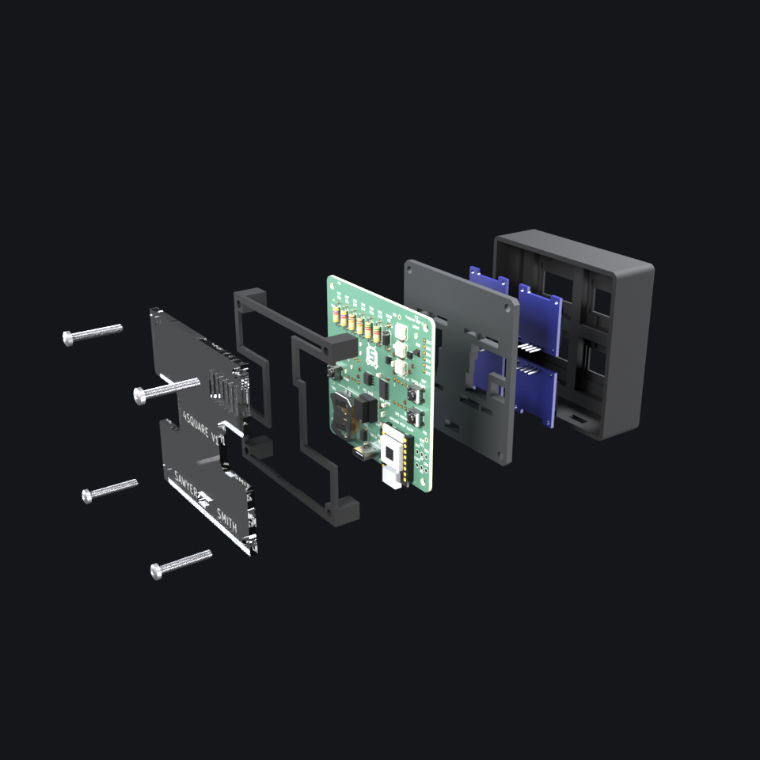

# Building a 4square

Assemble the clock front to back, in the same order the parts come together in
the exploded view.

## What you need

- one assembled rev O board with its hand-solder kit fitted (see
  [`hardware/ORDER-NOTES.md`](../hardware/ORDER-NOTES.md))
- an ESP32-C3 SuperMini
- four 0.96 in SSD1306 128x64 I2C OLED modules, all white
- the printed shell and both retainer halves
- for the acrylic back: the laser-cut panel and the printed standoff frame; or
  the printed back instead of both
- four M3 x 16 mm self-tapping screws
- a CR2032 cell (optional; it keeps time across power cuts)

Print and cut the parts as described in [`case/README.md`](../case/README.md).

## Order

1. **Shell.** Lay the printed shell front face down on the bench.
2. **Screens.** Drop the four OLED modules into their pockets, glass first, pins
   pointing up. The pockets locate them, so each should sit flat and square
   without being pushed.
3. **Retainer halves.** Lay both halves over the screens, pads down onto the
   modules. The halves meet on the centreline, and the notches in the pads
   leave room for each module's four pins. The retainer keeps the screens flat against the glass.
4. **Board.** Lower the board onto the shell's four corner bosses, screen side
   down, so the module pins pass through the board's screen headers. With the
   screens held by the pockets and the retainer, solder the screen pins now:
   that way the pockets, not the solder joints, decide where each screen ends
   up. The C3 SuperMini's USB-C port should land flush with the outside of the
   bottom wall.
5. **Standoff frame.** Set the frame on the back of the board, pegs over the
   four corner holes. Skip this step with the printed back, which has its
   standoffs built in.
6. **Acrylic back.** Lay the panel on the frame, engraved face inward, so the
   vent slots sit over the temperature sensor in the top-right corner (seen from
   the back) and the opening lines up with the rear USB-C port.
7. **Screws.** Drive the four M3 x 16 self-tapping screws through the back,
   frame and board into the shell's corner bosses. Snug them; overtightening
   strips the printed threads or cracks the acrylic.

## First power-up

1. Plug USB-C into either port. The rear port is for everyday power; the
   SuperMini's own port is the one to flash through.
2. Flash the firmware (the prebuilt demo image or your own build, see the
   main [README](../README.md#flash)).
3. If the clock chip has never been set, set it over serial at 115200:
   `T 2026 10 29 14 30 0` (year, month, day, hour, minute, second).
4. Press each button. MODE should cycle clock styles, SET show the readings,
   UP start the stopwatch and DOWN start the showreel.

If a screen stays dark, send `S` over serial to rescan the panels, and `?` for a
status report. [`hardware/HARDWARE.md`](../hardware/HARDWARE.md) has the bench
notes, including the LED orientation trap on rev O.
